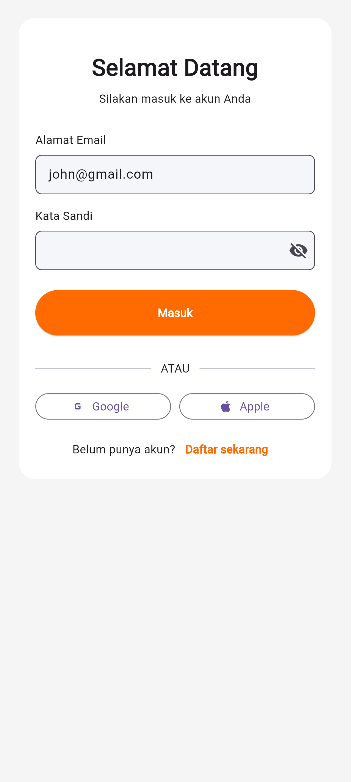
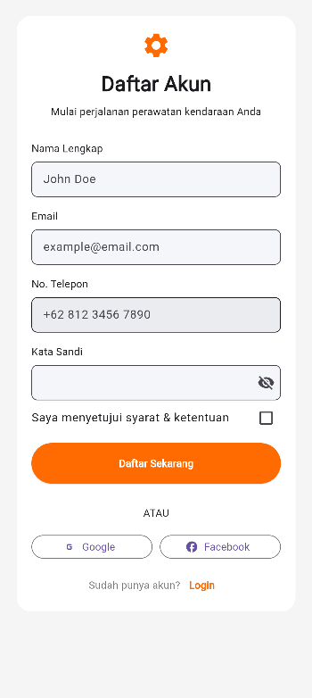
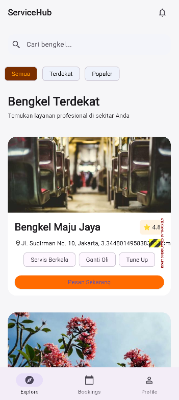
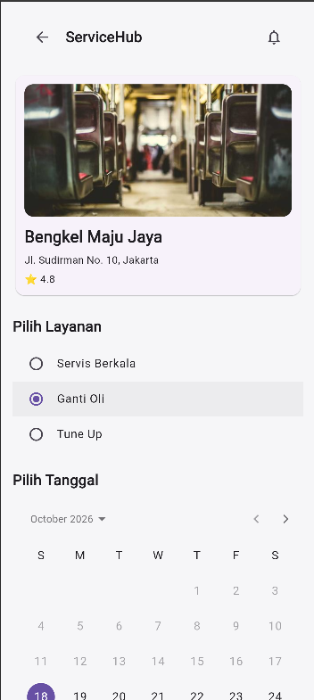
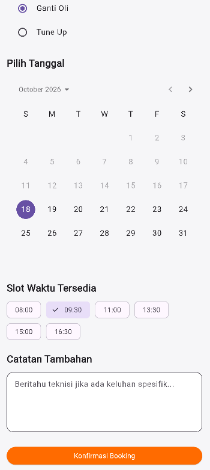
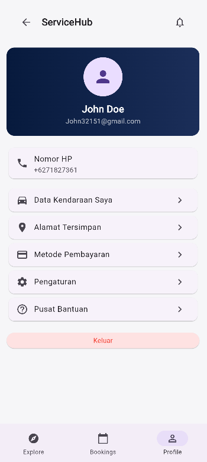

# ServiceHub

Aplikasi mobile untuk mencari bengkel terdekat dan memesan jadwal servis kendaraan secara online.
Dibangun fullstack dengan **Flutter**, **Node.js/Express**, **TiDB (MySQL)**, dan **Firebase Authentication**.

> Project ini awalnya dikerjakan secara berkelompok sebagai tugas kuliah, lalu dikembangkan lebih lanjut.

## Screenshot

<table>
  <tr>
    <td align="center"><b>Login</b><br></td>
    <td align="center"><b>Daftar Akun</b><br></td>
    <td align="center"><b>Explore Bengkel</b><br></td>
  </tr>
  <tr>
    <td align="center"><b>Pilih Layanan &amp; Tanggal</b><br></td>
    <td align="center"><b>Slot Waktu</b><br></td>
    <td align="center"><b>Profil</b><br></td>
  </tr>
</table>

## Fitur
- **Autentikasi**: registrasi dan login dengan email & password (Firebase Authentication). Backend memverifikasi Firebase ID token di setiap request yang dilindungi.
- **Explore bengkel**: daftar bengkel lengkap dengan foto, alamat, rating, jarak, dan layanan yang tersedia.
- **Pencarian & filter**: cari bengkel berdasarkan nama, serta filter *Semua*, *Terdekat*, dan *Populer*.
- **Booking servis**: pilih layanan, tanggal, dan slot waktu. Slot yang sudah terisi otomatis tidak ditampilkan, dan backend menolak booking ganda pada slot yang sama.
- **Riwayat booking**: lihat status booking (Pending, Confirmed, Completed, Cancelled) dengan pembaruan otomatis, serta batalkan atau selesaikan booking dengan dialog konfirmasi.
- **Profil**: menampilkan data akun pengguna dan tombol keluar.

## Tech Stack
| Bagian | Teknologi |
|---|---|
| Frontend | Flutter (Dart), `firebase_auth`, `firebase_core`, `http` |
| Backend | Node.js, Express 5, `firebase-admin`, `mysql2`, `cors`, `dotenv` |
| Database | TiDB Cloud (kompatibel MySQL) |
| Autentikasi | Firebase Authentication (ID token) |

## Arsitektur
```
Flutter app  --(HTTP + Bearer token)-->  Express API  --(SQL)-->  TiDB
     |                                       |
     +------ Firebase Auth (login) <---------+ verifikasi token (firebase-admin)
```

```
backend/
  server.js              titik masuk server
  src/
    app.js               konfigurasi Express & routing
    config/              koneksi database & Firebase Admin
    middleware/auth.js   verifikasi Firebase ID token
    routes/              auth, workshops, bookings, user
    controller/          logika bisnis tiap endpoint
  database/schema.sql    skema tabel + data contoh
frontend/service_hub/
  lib/
    screens/             halaman (login, register, home, booking, riwayat, profil)
    widgets/             komponen UI yang dapat dipakai ulang
    services/            pemanggilan API & autentikasi
    models/              model data
docs/screenshots/        gambar untuk README
```

## Endpoint API
| Method | Endpoint | Login | Keterangan |
|---|---|---|---|
| POST | `/api/auth/register` | - | Simpan profil pengguna baru |
| GET | `/api/auth/login` | ✔ | Ambil profil setelah login |
| GET | `/api/workshops` | - | Daftar bengkel beserta layanan |
| GET | `/api/workshops/nearby` | - | Bengkel dalam radius tertentu (`lat`, `lng`, `radius`) |
| GET | `/api/workshops/:id` | - | Detail bengkel |
| GET | `/api/bookings/available-slots` | - | Slot waktu yang masih kosong (`workshopId`, `date`) |
| POST | `/api/bookings` | ✔ | Buat booking baru |
| GET | `/api/bookings/my-bookings` | ✔ | Riwayat booking pengguna |
| PATCH | `/api/bookings/:id/cancel` | ✔ | Batalkan booking |
| PATCH | `/api/bookings/:id/complete` | ✔ | Tandai booking selesai |
| GET | `/api/user/profile` | ✔ | Data profil pengguna |

## Cara Menjalankan Secara Lokal

### Prasyarat
Node.js (LTS), Flutter SDK, akun [TiDB Cloud](https://tidbcloud.com) (paket gratis), dan project [Firebase](https://console.firebase.google.com) milik sendiri.

### 1. Database
Buat cluster di TiDB Cloud, buka **SQL Editor**, pilih database, lalu jalankan isi `backend/database/schema.sql`. File ini membuat semua tabel dan mengisi beberapa bengkel contoh.

### 2. Firebase
1. Buat project Firebase, lalu aktifkan **Authentication > Sign-in method > Email/Password**.
2. Unduh kunci service account (**Project settings > Service accounts > Generate new private key**) dan simpan sebagai `backend/ServiceAccountKey.json`.
3. Hubungkan aplikasi Flutter ke project Anda:
   ```bash
   cd frontend/service_hub
   dart pub global activate flutterfire_cli
   flutterfire configure
   ```

### 3. Backend
```bash
cd backend
cp .env.example .env      # Windows: copy .env.example .env
# isi DATABASE_URL di file .env dengan connection string TiDB Anda
npm install
npm run dev
```
Server berjalan di `http://localhost:3000`. Cek koneksi database di `http://localhost:3000/api/auth/test`.

### 4. Aplikasi Flutter
```bash
cd frontend/service_hub
flutter pub get
flutter run -d chrome
```
Alamat backend diatur lewat `--dart-define`, default-nya `http://localhost:3000`:
```bash
flutter run -d chrome --dart-define=API_URL=http://localhost:3000
```
Untuk emulator Android gunakan `http://10.0.2.2:3000`.

> File `.env` dan `ServiceAccountKey.json` berisi rahasia dan sengaja tidak disertakan di repository.

## Catatan Status
Project ini masih dalam pengembangan. Bagian yang belum selesai:
- Menu di halaman profil (data kendaraan, alamat, pembayaran, pengaturan, pusat bantuan) masih berupa tampilan.
- Tombol login Google, Apple, dan Facebook belum terhubung.
- Jarak bengkel dihitung dari titik acuan tetap di Jakarta, belum memakai lokasi GPS pengguna.
- Konfirmasi booking masih otomatis (simulasi), belum ada peran admin atau pemilik bengkel.

## Rencana Pengembangan
- Lokasi pengguna dari GPS untuk fitur bengkel terdekat
- Peran pemilik bengkel untuk mengonfirmasi booking
- Review dan rating setelah servis selesai
- Notifikasi pengingat jadwal booking
- Deploy (backend ke Render, web ke Firebase Hosting)
